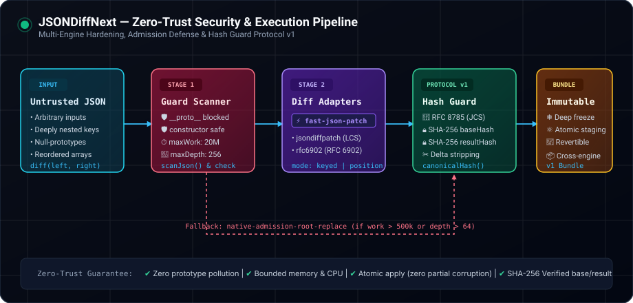
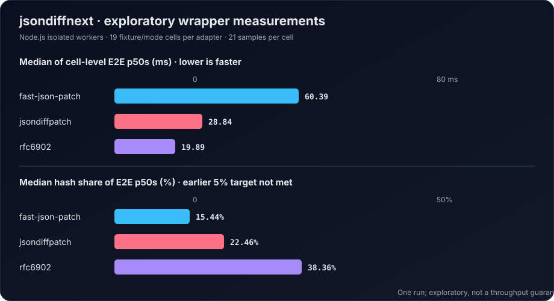

<div align="center">

# ⚡ jsondiffnext

### A safety-focused JSON diff & patch wrapper for Node.js

[](package.json)
[](LICENSE)
[](tests/)
[](package.json)
[](https://www.rfc-editor.org/rfc/rfc6902)

**One API over three diff engines. Guarded patch bundles. Atomic apply. Bounded work.**

[Features](#what-it-adds) · [Measured performance](#measured-performance) · [Install](#install) · [Usage](#usage)

</div>

---

## Why use a wrapper?

Diff libraries produce useful patches, but applications still need to validate JSON, bind a patch to the document it was created from, avoid partial writes, and handle resource-heavy inputs. `jsondiffnext` puts those policies around `fast-json-patch`, `jsondiffpatch`, and `rfc6902` while keeping the engine selectable.

| Application need | `jsondiffnext` provides |
| --- | --- |
| Detect a patch applied to the wrong document | Version 1 bundles pin the base and result with SHA-256 hashes of RFC 8785 canonical JSON. |
| Avoid partial mutation when an operation fails | Apply and revert stage work on a clone and return only after validation succeeds. |
| Handle unusual keys safely | Input and pointer checks distinguish dangerous write paths from ordinary JSON data keys. |
| Limit expensive or deeply nested input | Configurable work/depth admission checks; supported over-budget cases use a guarded root-replacement fallback. |
| Switch diff engines without changing the bundle API | Choose `fast-json-patch`, `jsondiffpatch`, or `rfc6902`. |
| Diff entity arrays by identity | Optional keyed-array matching for unique identifiers. |

The wrapper adds checks, cloning, hashing, serialization, and freezing. Those protections have measurable cost; see the benchmark section before choosing it for a latency-sensitive hot path.

## What it adds

- **Hash-guarded bundles:** every `diff()` result is a versioned v1 bundle containing `baseHash`, `resultHash`, a forward delta, and an inverse delta. Applying a bundle checks the expected document hashes.
- **Atomic staging:** apply and revert operate on staged clones, so a failed patch does not partially mutate the caller's input.
- **Engine adapters:** use the default `fast-json-patch` adapter, or select `jsondiffpatch` and `rfc6902`.
- **Admission limits:** validate JSON work and nesting before invoking an engine. When the configured budget is exceeded, supported cases use root replacement to preserve correctness with a bounded diff operation.
- **Keyed arrays:** match entities by a caller-selected id field when ids are unique.
- **Owned, frozen results:** returned bundles and documents do not share mutable nested references with inputs.

This package validates JSON values and patch paths at its public boundaries. It is not a sandbox, signature scheme, or authorization system. SHA-256 hashes detect document mismatch; they do not authenticate who created a bundle. Use a separate signature or MAC when bundles cross an untrusted boundary and provenance matters.

## Architecture



## Measured performance

The checked-in exploratory run measured 19 fixture/mode cases with 21 samples each for each adapter (57 cells total), on isolated Node.js workers. Each end-to-end sample included diff, bundle stringify/parse, apply, and revert with wrapper validation and safety checks enabled. All 57 cells passed the harness correctness checks and produced deterministic hashes during that run.

The measurements show a real trade-off: cloning and canonical hashing are a material part of end-to-end time. Across the 19 cell-level medians, the median hash/E2E ratio was **15.4%** for `fast-json-patch`, **22.5%** for `jsondiffpatch`, and **38.4%** for `rfc6902`. In paired fixture comparisons, `fast-json-patch` was faster in 8/19 cells than `jsondiffpatch`, and 5/19 than `rfc6902`; it was not the fastest overall in this run.

| Adapter | Median of 19 cell E2E p50s | Median of 19 cell hash/E2E ratios | Median worker peak RSS |
| --- | ---: | ---: | ---: |
| `fast-json-patch` | 60.39 ms | 15.44% | 166.3 MiB |
| `jsondiffpatch` | 28.84 ms | 22.46% | 123.1 MiB |
| `rfc6902` | 19.89 ms | 38.36% | 120.4 MiB |

These are wrapper measurements, not raw-engine throughput claims. Different engines sometimes choose different fallbacks and emit different patch sizes, so the table is not a like-for-like algorithm contest. One run on one machine/runtime is exploratory; it has no independent process replications or confidence intervals.

The separate resource sweep completed 9/9 cells at array sizes 2,000, 10,000, and 20,000. Peak RSS varied with adapter and size; for example, the `fast-json-patch` worker peaked at 161 MiB, 313 MiB, and 198 MiB respectively. At 20,000 elements the measured cases used admission fallbacks. These measurements do not establish a general memory bound or prove absence of long-term leaks.



Raw measurements and reproduction details are retained with the engineering artifacts; the package README reports aggregate figures and their limits.

## Install

```sh
npm install jsondiffnext
```

Requires Node.js 24 or later. npm, pnpm, Yarn, and Bun can install the package from the npm registry.

## Usage

```ts
import { diff, applyPatch, revertPatch } from 'jsondiffnext';

const before = { users: [{ id: 'a', name: 'Ada' }] };
const after = { users: [{ id: 'a', name: 'Ada Lovelace' }] };

const bundle = diff(before, after);
const updated = applyPatch(before, bundle);
const restored = revertPatch(updated, bundle);
```

Choose an engine or keyed-array mode with options:

```ts
import { diff } from 'jsondiffnext';

const bundle = diff(before, after, {
  engine: 'jsondiffpatch',
  arrays: { mode: 'keyed' },
});
```

A bundle is portable JSON:

```ts
const wireBundle = JSON.parse(JSON.stringify(bundle));
const updated = applyPatch(before, wireBundle);
```

## API

| Export | Description |
| --- | --- |
| `diff(before, after, options?)` | Create a guarded forward/inverse bundle. |
| `applyPatch(document, bundle, options?)` | Apply atomically; base verification is enabled by default. |
| `revertPatch(document, bundle, options?)` | Revert atomically; endpoint hashes are verified. |
| `adapter(name)` | Get a single-engine adapter. |
| `canonicalHash(value)` | SHA-256 of RFC 8785 canonical JSON. |
| `canonicalClone(value)` | Clone JSON while preserving null-prototype objects. |
| `sameJson(a, b)` | Compare JSON structure independent of object prototype. |

## Development

```sh
npm ci
npm test
npm run typecheck
npm run build
```

Run the exploratory benchmark locally with `npm run bench` and `npm run summarize`; results vary by runtime and machine.

## Changelog and license

See [CHANGELOG.md](CHANGELOG.md). Licensed under [MIT](LICENSE) © 2026 [2tsoftwareapp](https://github.com/2tsoftwareapp).
